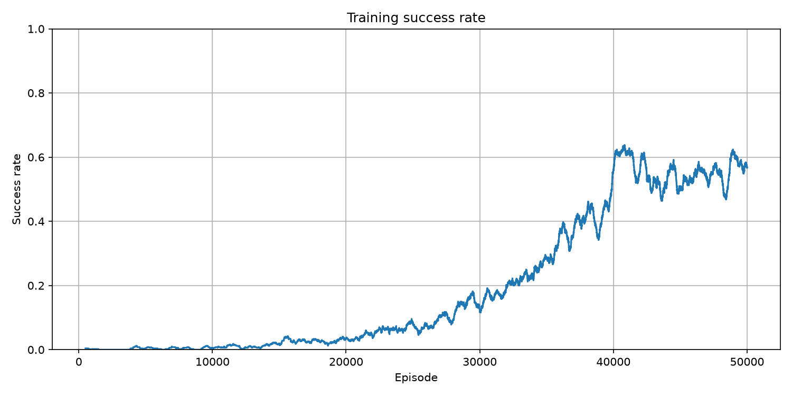
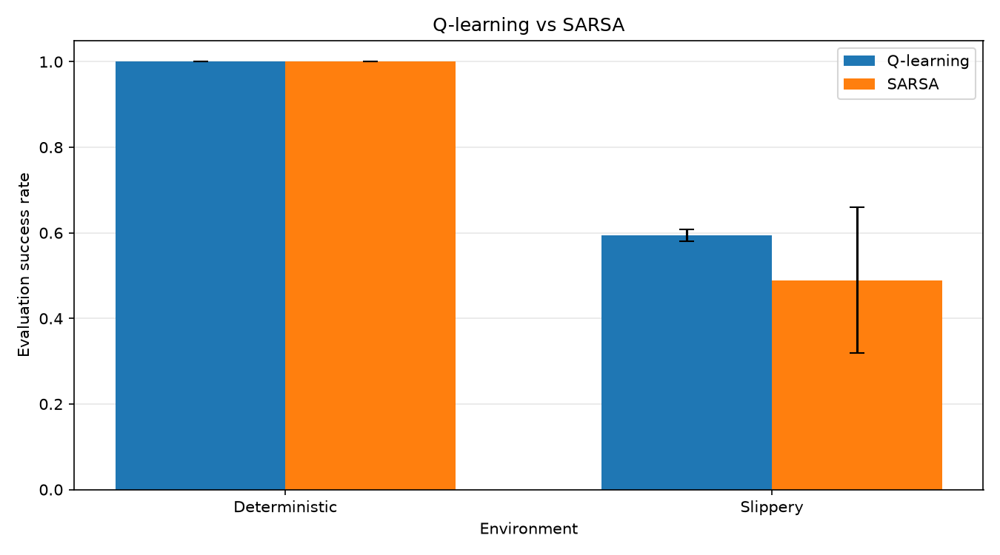

# FrozenLake：Q-learning与SARSA可复现实验

这是一个基于Python、NumPy和Gymnasium实现的表格型强化学习项目。项目在`FrozenLake-v1`上实现并比较Q-learning与SARSA，覆盖从环境交互、TD更新到多随机种子评估、模型保存、结果复现和可视化的完整实验流程。

```text
环境交互 → epsilon-greedy动作选择 → transition
→ TD target与Q表更新 → 独立贪婪评估
→ 保存Q表/配置/指标 → 多随机种子统计 → 可视化与复现
```

## 项目特性

- 从零实现Q-learning与SARSA的表格型更新；
- epsilon-greedy探索，并随机打破并列最大Q值；
- epsilon从1.0线性衰减到0.01；
- 正确区分`terminated`与`truncated`；
- 终止状态不自举，外部截断状态保留自举；
- 训练与评估分离，评估时关闭探索且不更新Q表；
- 支持4×4、8×8以及确定性/随机滑动环境；
- Q表、配置、指标和曲线分别保存；
- 支持三个随机种子的12组正式实验；
- 报告均值与样本标准差，不用单一种子判断算法优劣；
- 可在新进程加载Q表，并从已有`summary.json`独立生成对比图；
- 64项pytest自动化测试。

## 核心算法

Q-learning使用下一状态中最大的Q值构造TD目标：

```text
target = reward + gamma * max Q(next_state, action)
```

SARSA使用行为策略实际选择的下一动作构造TD目标：

```text
target = reward + gamma * Q(next_state, next_action)
```

两者都按以下方式更新：

```text
TD error = target - Q(state, action)
Q(state, action) += alpha * TD error
```

如果当前转移真正终止了任务，则不存在后续回报：

```text
target = reward
```

Q-learning的行为策略使用epsilon-greedy，但TD目标使用贪婪动作，因此是off-policy；SARSA的行为和更新都使用epsilon-greedy策略实际选择的动作，因此是on-policy。

## 正式实验结果

所有结果均为三个训练种子`42、123、2026`的“均值 ± 样本标准差”。评估采用独立环境、独立评估种子和`epsilon=0.0`。

### 8×8地图

训练50000回合，epsilon在前40000回合从1.0线性衰减到0.01；每个种子独立评估500回合。

| 环境 | 算法 | 最后500回合训练成功率 | 评估成功率 | 成功回合平均步数 |
|---|---|---:|---:|---:|
| 确定性 | Q-learning | 0.987 ± 0.002 | 1.000 ± 0.000 | 14.000 ± 0.000 |
| 确定性 | SARSA | 0.982 ± 0.016 | 1.000 ± 0.000 | 14.000 ± 0.000 |
| 随机滑动 | Q-learning | 0.537 ± 0.051 | 0.594 ± 0.014 | 63.296 ± 1.285 |
| 随机滑动 | SARSA | 0.532 ± 0.042 | 0.489 ± 0.171 | 63.678 ± 0.951 |

确定性8×8中，两种算法都稳定学到14步最短路径。随机滑动8×8中，Q-learning在当前配置下的平均成功率更高且种子间波动更小；SARSA三个种子的成功率分别为`0.552、0.620、0.296`，表现出较明显的种子敏感性。

### 4×4地图

训练5000回合，epsilon在前4000回合从1.0线性衰减到0.01；每个种子独立评估100回合。

| 环境 | 算法 | 最后500回合训练成功率 | 评估成功率 | 成功回合平均步数 |
|---|---|---:|---:|---:|
| 确定性 | Q-learning | 0.986 ± 0.006 | 1.000 ± 0.000 | 6.000 ± 0.000 |
| 确定性 | SARSA | 0.989 ± 0.005 | 1.000 ± 0.000 | 6.000 ± 0.000 |
| 随机滑动 | Q-learning | 0.697 ± 0.013 | 0.760 ± 0.020 | 40.426 ± 2.875 |
| 随机滑动 | SARSA | 0.702 ± 0.006 | 0.753 ± 0.021 | 37.736 ± 1.417 |

三个随机种子的结果只能描述当前环境和超参数下的实验现象，不能证明某种算法在所有任务中都更优。

## 可视化结果

8×8随机滑动SARSA的500回合滑动成功率曲线：



8×8中Q-learning与SARSA的多随机种子评估成功率对比。柱高是均值，误差棒是样本标准差：



## 项目结构

```text
FrozenLake/
├── agent.py              # epsilon-greedy、Q-learning和SARSA更新
├── train.py              # 单回合/多回合训练与epsilon衰减
├── evaluate.py           # 关闭探索的独立评估
├── experiment.py         # 单组实验、指标计算与产物保存
├── run_multiseed.py      # 多算法、多环境、多随机种子实验
├── visualize.py          # 滑动平均、训练曲线和对比图
├── plot_results.py       # 从已有summary.json独立生成对比图
├── artifacts.py          # Q表和JSON保存/加载
├── config.py             # 环境、训练、种子与输出路径配置
├── main.py               # 当前配置的单组训练入口
├── evaluate_saved.py     # 加载已保存Q表并独立评估
├── probe.py              # Gymnasium环境接口探针
├── tests/                # pytest自动化测试
├── outputs/              # 运行生成物与展示图片
├── requirements.txt
└── README.md
```

## 环境与安装

项目验证环境：

- Python 3.13.5
- Gymnasium 1.4.0
- NumPy 2.5.1
- Matplotlib 3.11.2
- pytest 8.3.4

创建虚拟环境并安装依赖：

```bash
python -m venv .venv
```

Windows PowerShell：

```powershell
.\.venv\Scripts\Activate.ps1
python -m pip install -r requirements.txt
```

Linux或macOS：

```bash
source .venv/bin/activate
python -m pip install -r requirements.txt
```

## 使用方法

以下命令均在项目根目录运行。

### 1. 检查Gymnasium环境接口

```bash
python probe.py
```

### 2. 运行当前单组实验

```bash
python main.py
```

当前配置由`config.py`控制。单组实验会保存：

- Q表；
- 配置快照；
- 训练与评估指标；
- 训练滑动成功率曲线。

### 3. 加载已保存Q表并评估

```bash
python evaluate_saved.py
```

该入口不会训练或修改Q表，只会加载当前配置对应的checkpoint，并使用`epsilon=0.0`进行独立评估。

### 4. 运行正式多随机种子实验

```bash
python run_multiseed.py
```

默认组合为：

```text
3个训练种子 × 2种算法 × 2种环境 = 12组实验
```

该命令会重新训练全部组合，运行时间明显长于单组实验。

### 5. 从已有结果重新生成对比图

```bash
python plot_results.py
```

该入口只读取当前配置对应的`summary.json`，不会启动Gymnasium环境，也不会重新训练。如果对应汇总文件不存在，会抛出`FileNotFoundError`。

### 6. 运行自动化测试

```bash
python -m pytest -q
```

当前64项测试覆盖：

- epsilon-greedy与并列最大动作处理；
- Q-learning与SARSA普通、终止和截断更新；
- epsilon线性衰减；
- 单回合与多回合训练；
- 训练/评估环境分离；
- Q表与JSON保存、加载；
- 多种子组合、汇总均值与样本标准差；
- 滑动平均、训练曲线和算法对比图；
- 独立加载评估与独立绘图入口。

## 当前默认配置

| 参数 | 数值 |
|---|---:|
| 地图 | 8×8 |
| 环境 | 随机滑动 |
| 当前单组算法 | SARSA |
| 训练回合 | 50000 |
| 评估回合 | 500 |
| 学习率`alpha` | 0.1 |
| 折扣因子`gamma` | 0.99 |
| epsilon起点 | 1.0 |
| epsilon终点 | 0.01 |
| epsilon衰减回合 | 40000 |
| 单回合最大步数 | 200 |
| 训练种子 | 42、123、2026 |
| 评估种子 | 对应训练种子 + 10000 |
| 曲线滑动窗口 | 500 |

## 输出结构

每个独立实验保存到互不覆盖的目录：

```text
outputs/<algorithm>/<map>_<mode>/<experiment_tag>/seed_<seed>/
├── config.json
├── metrics.json
├── checkpoints/
│   └── q_table.npy
└── curves/
    └── training_success_rate.png
```

多随机种子汇总保存为：

```text
outputs/comparisons/<map>_q_learning_vs_sarsa/<experiment_tag>/
├── runs.json
├── summary.json
└── curves/
    └── evaluation_success_rate.png
```

`runs.json`记录每次运行的配置、指标和产物路径；`summary.json`保存每个环境/算法组合的原始种子结果、均值和样本标准差。

## 可复现性设计

- 环境随机种子和动作选择随机数生成器均显式设置；
- 同一环境与训练种子下，两种算法使用相同的训练/评估种子；
- 评估种子与训练种子分离；
- 训练和评估使用不同的环境实例；
- 评估固定`epsilon=0.0`且不更新Q表；
- 配置、指标、Q表和曲线按实验标签与种子隔离；
- 依赖版本固定在`requirements.txt`；
- 已验证独立评估前后Q表SHA-256保持不变。

## 结果解释边界

- 当前正式实验只使用三个训练种子，足以暴露明显波动，但不足以支持普遍性的算法优劣结论；
- 随机滑动环境中的最终结果会受到随机种子、训练回合、学习率和探索调度影响；
- 训练曲线采用500回合滑动窗口，展示的是局部平均成功率，不是单回合奖励；
- 平均步数会受到失败和截断回合影响，因此项目同时记录全部回合与成功回合的平均步数；
- 该项目聚焦表格型强化学习，后续可扩展到CliffWalking、DQN与DDQN。
